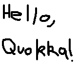

# Hello, Quokka!

In this tutorial you'll write a Quokka program that fills the Game Boy's screen with a picture. Instead of using
ready-made graphics, you'll start from an ordinary PNG and go through every step needed to get it on screen:

1. Convert the PNG into Game Boy tile data with `rgbgfx`.
2. Dump that data as bytes you can paste into Quokka source code.
3. Write a program that copies the bytes into video memory and turns on the screen.
4. Build the ROM and run it in an emulator.

The program is based on the "Hello, World!" program from the [GB ASM tutorial](https://gbdev.io/gb-asm-tutorial/),
which is also available as a Quokka program in the repository at
[`examples/hello_world.q`](https://github.com/jhinch/quokka-lang/blob/main/examples/hello_world.q).

Before starting, make sure Quokka and RGBDS are [installed](installation.md).

## Setting up

Create a directory for the project:

```sh
mkdir hello-quokka
cd hello-quokka
```

You'll need a 160×144 pixel image, which is the size of the Game Boy's screen. You can draw your own (see
[Image requirements](#image-requirements)) or download the one used in this tutorial,
[`hello-quokka.png`](hello-quokka.png), into the project directory:



## How the Game Boy draws the background

The Game Boy doesn't have a framebuffer you can write individual pixels into. Instead, the picture processing unit
(PPU) builds the background out of three pieces of data:

- **Tiles**: 8×8 pixel images. Each pixel is one of four colors, numbered 0 to 3, so a pixel needs two bits. A tile is
  stored as 16 bytes, two bytes per row of 8 pixels. The first byte of a row holds the low bit of each pixel's color
  and the second byte holds the high bit, with the leftmost pixel in the most significant bit. This is called the
  _2bpp_ (two bits per pixel) format.
- **The tilemap**: a 32×32 grid of bytes, starting at address `0x9800` in video memory (VRAM). Each byte selects which
  tile to draw in that cell. The background is 256×256 pixels, but the screen only shows a 160×144 pixel window of
  it, which is the top-left 20×18 tiles.
- **The palette**: the color numbers in a tile don't specify a shade directly. The background palette register
  `BGP` maps each color number to one of the four shades the screen can display, from white to black.

The background in this tutorial reads its tiles from the block that starts at `0x9000`. In that mode, tile number 0
is at `0x9000`, tile 1 at `0x9010`, and so on. For more details, see the
[Pan Docs](https://gbdev.io/pandocs/Graphics.html).

So drawing the picture means cutting the image into 8×8 tiles, storing each distinct tile once, and filling the
tilemap with the tile number for each cell of the screen. That's exactly what `rgbgfx` does for you.

## Converting the image with `rgbgfx`

Run `rgbgfx` on the image:

```sh
rgbgfx -c '#ffffff,#aaaaaa,#555555,#000000' -u -o hello-quokka.2bpp -t hello-quokka.tilemap hello-quokka.png
```

The options mean:

- `-c '#ffffff,#aaaaaa,#555555,#000000'` sets which image color becomes which color number: white is 0, light gray 1,
  dark gray 2 and black 3. Without it, `rgbgfx` chooses the order itself, and the picture could come out with its
  shades swapped. Fixing the order means the palette can map each color number straight to the matching shade.
- `-u` stores each distinct tile only once. A 160×144 image is 20 × 18 = 360 tiles, but most of them are repeats
  (the blank background is the same tile over and over), so the example image needs only 116 tiles.
- `-o hello-quokka.2bpp` writes the tile data, in the 2bpp format, to `hello-quokka.2bpp`.
- `-t hello-quokka.tilemap` writes the tilemap, one byte per tile, to `hello-quokka.tilemap`.

Check the sizes of the two files:

```console
$ wc -c hello-quokka.2bpp hello-quokka.tilemap
    1856 hello-quokka.2bpp
     360 hello-quokka.tilemap
    2216 total
```

The tile data is 116 tiles × 16 bytes = 1856 bytes. The tilemap is 20 × 18 = 360 bytes, one byte for each tile on
the screen. You'll need both sizes when declaring the arrays in Quokka.

### Image requirements

If you draw your own image, it must:

- be 160×144 pixels, so that it fills the screen exactly;
- use at most the four colors listed in the `-c` option (pure black and white are fine);
- contain at most **128 distinct tiles**. With the tile block at `0x9000`, tiles 0 to 127 sit between `0x9000`
  and `0x97FF`. Copying any more would run into the tilemap at `0x9800`. Large areas of one solid color keep the
  count down. To find the count, divide the size of the `.2bpp` file by 16.

## Turning the bytes into Quokka arrays

Quokka doesn't have a way to include a binary file directly, so the tile data and tilemap go into the program as
array constants. `hexdump` can print a file's bytes in exactly the syntax a Quokka array expects.

### The tile data

Print the tile data as one tile (16 bytes) per line:

```sh
hexdump -v -e '16/1 "0x%02x, " "\n"' hello-quokka.2bpp
```

The format string after `-e` is applied over and over until the file runs out:

- `16/1 "0x%02x, "` formats 16 units of 1 byte each, printing each as a two-digit hexadecimal number followed by a
  comma.
- `"\n"` ends the line.

The `-v` option matters. By default, `hexdump` replaces repeated lines with a single `*`, which would silently drop
tiles that happen to be identical to the one before.

The output starts with the blank tile, followed by the start of the "H":

```text
0x00, 0x00, 0x00, 0x00, 0x00, 0x00, 0x00, 0x00, 0x00, 0x00, 0x00, 0x00, 0x00, 0x00, 0x00, 0x00,
0x00, 0x00, 0x01, 0x01, 0x03, 0x03, 0x03, 0x03, 0x03, 0x03, 0x03, 0x03, 0x03, 0x03, 0x03, 0x03,
...
```

Read the second line two bytes at a time. Row 0 of that tile is `0x00, 0x00`, so all 8 pixels are color 0 (white).
Row 1 is `0x01, 0x01`: the last pixel has both its low and high bits set, so it is color 3 (black), the start of
the "H"'s left stroke.

### The tilemap

The tilemap from `rgbgfx` has 20 bytes per row, one for each tile across the screen, but VRAM's tilemap is 32 tiles
wide. Each row needs another 12 bytes to fill out the rest of the row, which is off screen. `hexdump` can add those
while it formats the bytes:

```sh
hexdump -v -e '20/1 "0x%02x, " " 0, 0, 0, 0, 0, 0, 0, 0, 0, 0, 0, 0,\n"' hello-quokka.tilemap
```

This time each line formats 20 bytes and then prints twelve `0` entries. Those cells are never visible, so it doesn't
matter which tile they point at. The output is 18 lines of 32 entries, 576 bytes in all:

```text
0x00, 0x00, 0x00, 0x00, 0x00, 0x00, 0x00, 0x00, 0x00, 0x00, 0x00, 0x00, 0x00, 0x00, 0x00, 0x00, 0x00, 0x00, 0x00, 0x00, 0, 0, 0, 0, 0, 0, 0, 0, 0, 0, 0, 0,
0x01, 0x02, 0x03, 0x00, 0x00, 0x00, 0x04, 0x05, 0x00, 0x06, 0x00, 0x00, 0x00, 0x00, 0x00, 0x00, 0x00, 0x00, 0x00, 0x00, 0, 0, 0, 0, 0, 0, 0, 0, 0, 0, 0, 0,
...
```

You can see the picture's layout in the numbers. The top row of tiles is blank (tile 0), and the second row starts
with tiles 1, 2 and 3, which are the top of the "H".

## Writing the program

Create a file named `hello_quokka.q`. The program has three parts: names for the hardware registers and memory it
uses, the graphics data, and a `main` function that puts them together.

### Hardware registers

The Game Boy is controlled by writing to hardware registers at fixed memory addresses. In Quokka, you give a register
a name by declaring a [global](../reference/items/global-items.md) with the
[`address` attribute](../reference/attributes.md), which places the global at that exact address. Reading or writing
the global then reads or writes the register:

```quokka
// Audio master control. Writing 0 turns the audio hardware off.
#[address = 0xFF26]
global rAUDENA: u8;
const AUDIO_OFF: u8 = 0;

// The line the LCD is currently drawing. Lines 144 to 153 are the vertical blanking period.
#[address = 0xFF44]
global rLY: u8;
const LY_VBLANK: u8 = 144;

// LCD control. Bit 7 turns the LCD on and bit 0 turns the background on.
#[address = 0xFF40]
global rLCDC: u8;
const LCDC_OFF: u8 = 0b0000_0000;
const LCDC_ON: u8 = 0b1000_0000;
const LCDC_BG_ON: u8 = 0b0000_0001;

// Background palette. Bits 1-0 set the shade for color 0, bits 3-2 for color 1, and so on.
#[address = 0xFF47]
global rBGP: u8;
const BG_PALETTE: u8 = 0b1110_0100;
```

The [constants](../reference/items/const-items.md) give names to the values written to the registers. Quokka
substitutes a constant's value wherever the constant is used, so they cost nothing at runtime.

`BG_PALETTE` is `0b11_10_01_00`. Reading it in pairs of bits from the right, color 0 gets shade 0 (white), color 1
gets shade 1 (light gray), color 2 gets shade 2 (dark gray) and color 3 gets shade 3 (black). Because the `-c`
option put the image's colors in the same order, each pixel appears in its original shade.

### Video memory

The same `address` attribute can place an [array](../reference/types.md) over a region of memory. These two globals
cover the parts of VRAM that the program fills, with the sizes you measured earlier:

```quokka
#[address = 0x9000]
global BG_TILES: [u8; 1856];
#[address = 0x9800]
global BG_TILEMAP: [u8; 576];
```

### The graphics data

Next, add two array constants and paste the `hexdump` output between the brackets:

```quokka,ignore
const TILES: [u8; 1856] = [
    0x00, 0x00, 0x00, 0x00, 0x00, 0x00, 0x00, 0x00, 0x00, 0x00, 0x00, 0x00, 0x00, 0x00, 0x00, 0x00,
    0x00, 0x00, 0x01, 0x01, 0x03, 0x03, 0x03, 0x03, 0x03, 0x03, 0x03, 0x03, 0x03, 0x03, 0x03, 0x03,
    // ... the rest of the hexdump output for hello-quokka.2bpp
];
const TILEMAP: [u8; 576] = [
    0x00, 0x00, 0x00, 0x00, 0x00, 0x00, 0x00, 0x00, 0x00, 0x00, 0x00, 0x00, 0x00, 0x00, 0x00, 0x00, 0x00, 0x00, 0x00, 0x00, 0, 0, 0, 0, 0, 0, 0, 0, 0, 0, 0, 0,
    0x01, 0x02, 0x03, 0x00, 0x00, 0x00, 0x04, 0x05, 0x00, 0x06, 0x00, 0x00, 0x00, 0x00, 0x00, 0x00, 0x00, 0x00, 0x00, 0x00, 0, 0, 0, 0, 0, 0, 0, 0, 0, 0, 0, 0,
    // ... the rest of the hexdump output for hello-quokka.tilemap
];
```

Quokka allows a trailing comma after the last item, so the output can be pasted in as is. The array length in the
type must match the number of items exactly. If it doesn't, the compiler reports an error, which is a useful check
that nothing was lost when copying.

Large constants like these are stored in the ROM, so they don't use any of the Game Boy's limited RAM.

### The `main` function

A Quokka program starts at its `main` [function](../reference/items/functions.md):

```quokka,ignore
fn main() {
    // Turn the audio off, we won't be using it
    rAUDENA = AUDIO_OFF;

    // Wait for vblank, as the LCD must only be turned off during vblank
    loop {
        if rLY >= LY_VBLANK then {
            break;
        }
    }
    // Turn the LCD off so we can freely write to VRAM
    rLCDC = LCDC_OFF;

    // Copy the tiles and the tilemap into VRAM
    BG_TILES = TILES;
    BG_TILEMAP = TILEMAP;

    // Turn the LCD back on with the background enabled
    rLCDC = LCDC_ON | LCDC_BG_ON;
    // Set the background palette
    rBGP = BG_PALETTE;
}
```

Step by step:

1. **Turn the audio off.** The program doesn't play any sound, so there's no reason to leave the audio hardware
   running.
2. **Wait for vertical blanking.** While the PPU is drawing the screen, it has VRAM to itself, and the CPU can't
   read or write it reliably. Copying 2432 bytes takes far longer than the short gap between frames, so the program
   turns the LCD off for the copy instead. The LCD may only be turned off during the vertical blanking period
   ("vblank"), because turning it off at any other time can damage a real Game Boy's screen. The
   [`loop`](../reference/expressions/loops.md) keeps reading `rLY` until the LCD reaches line 144, which is where
   vblank starts, and then [`break`](../reference/statements/breaks.md)s out.
3. **Turn the LCD off.** VRAM can now be accessed freely.
4. **Copy the tiles and the tilemap.** Assigning a whole array to another array of the same type copies every
   element. This is a [bulk copy](../reference/expressions/operators.md#bulk-copy), and the compiler generates the
   copy loop for you. Each array constant has exactly the same type as the VRAM global it's copied into, which is
   another reason the array lengths have to match the file sizes.
5. **Turn the LCD on** with the background enabled, using `|` to combine the two flags.
6. **Set the palette.** This is safe to do straight away, because the LCD always starts drawing from the top of a
   new frame when it's turned on.

When `main` returns, the program has nothing left to do and the Game Boy idles, still showing the picture.

### The complete program

Put together, `hello_quokka.q` looks like this, with the graphics data shortened:

```quokka,ignore
#[address = 0xFF26]
global rAUDENA: u8;
const AUDIO_OFF: u8 = 0;

#[address = 0xFF44]
global rLY: u8;
const LY_VBLANK: u8 = 144;

#[address = 0xFF40]
global rLCDC: u8;
const LCDC_OFF: u8 = 0b0000_0000;
const LCDC_ON: u8 = 0b1000_0000;
const LCDC_BG_ON: u8 = 0b0000_0001;

#[address = 0xFF47]
global rBGP: u8;
const BG_PALETTE: u8 = 0b1110_0100;

#[address = 0x9000]
global BG_TILES: [u8; 1856];
#[address = 0x9800]
global BG_TILEMAP: [u8; 576];

const TILES: [u8; 1856] = [
    0x00, 0x00, 0x00, 0x00, 0x00, 0x00, 0x00, 0x00, 0x00, 0x00, 0x00, 0x00, 0x00, 0x00, 0x00, 0x00,
    // ...
];
const TILEMAP: [u8; 576] = [
    0x00, 0x00, 0x00, 0x00, 0x00, 0x00, 0x00, 0x00, 0x00, 0x00, 0x00, 0x00, 0x00, 0x00, 0x00, 0x00, 0x00, 0x00, 0x00, 0x00, 0, 0, 0, 0, 0, 0, 0, 0, 0, 0, 0, 0,
    // ...
];

fn main() {
    rAUDENA = AUDIO_OFF;

    loop {
        if rLY >= LY_VBLANK then {
            break;
        }
    }
    rLCDC = LCDC_OFF;

    BG_TILES = TILES;
    BG_TILEMAP = TILEMAP;

    rLCDC = LCDC_ON | LCDC_BG_ON;
    rBGP = BG_PALETTE;
}
```

The full program, with all of the graphics data for the example image, is in the repository at
[`examples/hello_quokka.q`](https://github.com/jhinch/quokka-lang/blob/main/examples/hello_quokka.q).

## Building and running

Compile the program:

```sh
quokka build hello_quokka.q
```

Quokka writes its output to a `build` directory next to the source file:

- `build/hello_quokka.gb`: the ROM
- `build/hello_quokka.obj`: the object file passed to `rgblink`
- `build/hello_quokka.sym`: the symbol file from `rgblink`, which many emulators' debuggers can load to show names
  instead of addresses

Open `build/hello_quokka.gb` in a Game Boy emulator, such as [SameBoy](https://sameboy.github.io/),
[Emulicious](https://emulicious.net/) or [BGB](https://bgb.bircd.org/). After the boot logo, you should see your
picture.

If the picture looks wrong:

- **Shades are swapped or inverted**: check the `-c` option given to `rgbgfx` and the value of `BG_PALETTE`.
- **The picture is scrambled or shifted**: check that both `hexdump` commands included `-v`, and that the tilemap
  rows were padded to 32 entries.
- **The compiler reports that an array has the wrong length**: some of the `hexdump` output is missing, or the
  array type doesn't match the file sizes from `wc -c`.

## Next steps

Try it with an image of your own. Every image follows the same steps. Only the array lengths change to match the new
file sizes.

From here, the [reference](../reference/lexical-structure.md) describes everything Quokka can do, including
[structs](../reference/items/structs.md), [functions](../reference/items/functions.md) and the full set of
[operators](../reference/expressions/operators.md).
